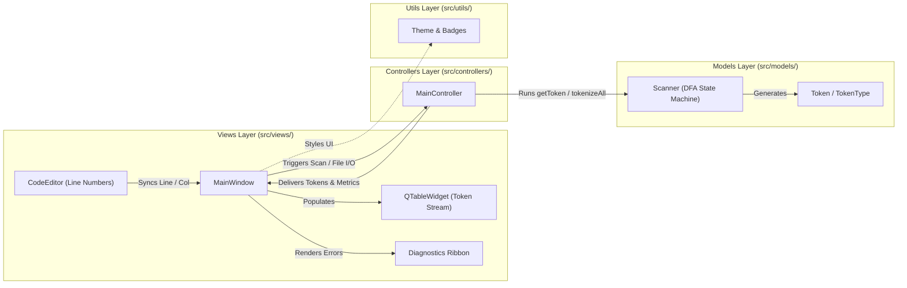

# TINY Language Lexical Analyzer Studio

[](https://en.cppreference.com/w/cpp/17)
[](https://www.qt.io/)
[-0078D6?logo=windows)](https://github.com)
[](LICENSE)

A professional desktop lexical analyzer (scanner) application for the **TINY Programming Language**, engineered in **Modern C++ (C++17)** and **Qt Widgets**. Built in strict accordance with Kenneth C. Louden's compiler construction specifications and the course requirements, featuring an organized **Model-View-Controller (MVC)** architecture, a deterministic finite automaton (DFA) state machine, real-time error diagnostics, and automated standalone Windows executable packaging.

---

## Visual Design & User Interface

The application interface implements the **Developer Minimalism** design system specified in Google Stitch project **`TINY Lexical Analyzer Studio`**:

- **Dark Mode Ergonomics:** Built upon deep charcoal surfaces (`#131313`, `#1E1E22`, `#202020`) with semantic accent highlights (`#007ACC` primary blue, `#61DAC1` identifier mint, `#F6BB84` literal amber, `#FFB4AB` error red).
- **Split-Pane Layout (`QSplitter`):** Dynamically resizable 50/50 split dividing the source code editor from the analysis grid.
- **Trigger Center (`Scan Code`):** The `Scan Code` hero action button acts as the central execution trigger; loading a file populates the editor without auto-running, giving the user explicit control over when lexical analysis starts.
- **Alerting Red `Clear` Button:** Highlighted with a distinct red palette (`#381518`, `#78262C` border, `#FFA4A8` text) to clearly signal destructive state clearing.
- **Prominent `Export Tokens` Button:** Positioned at the top-right corner of the toolbar for immediate one-click file exports.
- **Monospaced Code Editor (`CodeEditor`):** Custom line-number gutter, active line tracking, and automatic line-jump highlighting for compiler errors.
- **Structured Token Grid (`QTableWidget`):** Color-coded category chips, lexeme strings, token types, and syntactic descriptions.
- **Interactive Search Filter:** Real-time filtering across lexemes, categories, and token types.
- **Diagnostics Ribbon:** Visual warning bar with error codes (`LEX_ERR_001`), line and column indicators, and one-click **"Go to line"** navigation.

---

## Architecture Overview (MVC Pattern)

The codebase is organized into dedicated subdirectories separating concerns:



### Component Breakdown
1. **Models Layer (`src/models/`):**
   - Pure C++17 without GUI dependencies; can be compiled and verified independently.
   - `Token.h` / `Token.cpp`: Strongly typed `TokenType` enum and `Token` structure storing lexeme string values, source positions, and export formatting.
   - `Scanner.h` / `Scanner.cpp`: Implements the `getToken()` lexical state machine, whitespace stripping, comment removal (`{ ... }` and `// ...`), and maximal munch lookahead.
2. **Controllers Layer (`src/controllers/`):**
   - `MainController.h` / `MainController.cpp`: Coordinates file I/O with UTF-8 encoding, token export formatting, and scan benchmarking (`std::chrono`).
3. **Views Layer (`src/views/`):**
   - `MainWindow.h` / `MainWindow.cpp`: Desktop GUI, menus, toolbars, split-pane layout, and diagnostics alert ribbon.
   - `CodeEditor.h` / `CodeEditor.cpp`: Line-number gutter painting, cursor tracking, and error line jumping.
4. **Utils Layer (`src/utils/`):**
   - `Theme.h` / `Theme.cpp`: QSS application stylesheet and HTML badge generators for token categories.

---

## TINY Language Lexical Specification

### 1. Recognized Token Set
| Token Type | Value / Syntax Example | Category | Description |
| :--- | :--- | :--- | :--- |
| `SEMICOLON` | `;` | Delimiter | Statement Terminator |
| `IF` | `if` | Keyword | Conditional Branch Introducer |
| `THEN` | `then` | Keyword | Conditional Consequent Block |
| `ELSE` | `else` | Keyword | Conditional Alternative Block |
| `END` | `end` | Keyword | Block Terminus |
| `REPEAT` | `repeat` | Keyword | Iteration Loop Introducer |
| `UNTIL` | `until` | Keyword | Loop Termination Condition |
| `READ` | `read` | Keyword | Input Instruction |
| `WRITE` | `write` | Keyword | Output Instruction |
| `ASSIGN` | `:=` | Operator | Variable Assignment |
| `EQUAL` | `=` | Operator | Equality Comparison |
| `LESSTHAN` | `<` | Operator | Relational Less-Than Comparison |
| `PLUS` | `+` | Operator | Arithmetic Addition |
| `MINUS` | `-` | Operator | Arithmetic Subtraction |
| `MULT` | `*` | Operator | Arithmetic Multiplication |
| `DIV` | `/` | Operator | Arithmetic Division |
| `OPENBRACKET` | `(` | Delimiter | Left Grouping Parenthesis |
| `CLOSEDBRACKET` | `)` | Delimiter | Right Grouping Parenthesis |
| `IDENTIFIER` | `x`, `abc`, `fact`, `temp1` | Identifier | Sequence of letters and alphanumerics |
| `NUMBER` | `0`, `12`, `289` | Number | Sequence of decimal digits |
| `UNKNOWN` | `@`, `$`, `#`, lone `:`, etc. | Error | Unrecognized symbol or invalid sequence |

### 2. DFA State Machine
The lexical analyzer operates as a Deterministic Finite Automaton with the following states:
- `START`: Initial state scanning incoming characters.
- `INNUM`: Accumulates digits until a non-digit delimiter is encountered (lookahead character unread).
- `INID`: Accumulates alphanumeric characters until a non-alphanumeric character is encountered; checks reserved keywords table.
- `INASSIGN`: Encountered `:`; expects `=`. If `=`: returns `ASSIGN` (`:=`); otherwise reports `UNKNOWN` error.
- `INCOMMENT_CURLY`: Consumes characters inside curly braces `{ ... }` until `}` is reached.
- `INCOMMENT_LINE`: Consumes single-line comments (`// ...`) until newline or EOF.
- `DONE`: Final state returning the extracted `Token`.

---

## Input Modes & File I/O Specifications

The scanner takes two types of inputs:
1. **File Input via `QFileDialog`:** Click **"Open File"** or press `Ctrl+O` to load `.tny` or `.txt` source files.
2. **Direct Code Writing / Copy-Paste:** Directly type or paste TINY code into the left editor pane.

### Triggering Analysis
Click **"Scan Code"** (or press `F5`) to trigger lexical analysis on the loaded or edited source text.

### Exporting Tokens
Click **"Export Tokens"** (or press `Ctrl+S`) at the top-right toolbar to dump the generated token sequence into a text file in the required format:
```text
<tokenvalue> , <tokentype>
```

#### Example Output:
```text
read , READ
x , IDENTIFIER
; , SEMICOLON
if , IF
0 , NUMBER
< , LESSTHAN
x , IDENTIFIER
then , THEN
fact , IDENTIFIER
:= , ASSIGN
1 , NUMBER
; , SEMICOLON
```

---

## Automated Standalone Windows Executable CI/CD

This repository includes a production-grade GitHub Actions workflow (`.github/workflows/build_windows.yml`) that automatically:
1. Triggers on any `git push` or `pull_request`.
2. Sets up the MSVC compiler toolchain, CMake, and Ninja on a clean `windows-latest` runner.
3. Installs Qt 6.6 via `jurplel/install-qt-action`.
4. Compiles the project and runs the automated unit test suite (`ctest`).
5. Invokes `windeployqt` to collect all required Qt shared libraries (`Qt6Core.dll`, `Qt6Gui.dll`, `Qt6Widgets.dll`, `qwindows.dll` platform plugin, styles, etc.).
6. Packages the standalone executable and assets into **`TINY-Lexical-Analyzer-Windows-x64.zip`**.
7. Publishes the zip archive as an artifact downloadable directly from GitHub without needing Qt or C++ development tools installed on your PC.

---

## Local Build Instructions

### Prerequisites
- **Compiler:** GCC 9+ (MinGW-w64), Clang, or MSVC 2019/2022 (C++17 support required).
- **Build System:** CMake 3.16 or later.
- **Framework:** Qt 6 (6.2+) or Qt 5 (5.15+).

### 1. Configure and Build (CLI)
```powershell
# Clone the repository
git clone https://github.com/youssef-osama11/TINY-Language-Compiler.git
cd TINY-Language-Compiler

# Create build directory
mkdir build
cd build

# Configure with CMake
cmake .. -DCMAKE_BUILD_TYPE=Release

# Build executable and unit tests
cmake --build . --config Release
```

### 2. Run the Unit Tests
```powershell
ctest --output-on-failure
# Or run standalone unit test binary:
./ScannerUnitTests
```

---

## Testing Assets
The `/assets` directory contains sample TINY files for manual testing and verification:
1. **`assets/sample1_factorial.tny`:** Louden's classic factorial algorithm.
2. **`assets/sample2_invalid.tny`:** Demonstration of invalid characters (`@`, lone `:`, `$`, `#`).
3. **`assets/sample3_fibonacci.tny`:** Fibonacci series computation in TINY.

---

## Project Structure

```text
TINY-Language-Compiler/
├── .github/
│   └── workflows/
│       └── build_windows.yml         # Automated standalone .exe build & packaging
├── assets/
│   ├── sample1_factorial.tny         # Sample TINY program for testing
│   ├── sample2_invalid.tny           # Sample program with lexical errors
│   └── sample3_fibonacci.tny         # Sample Fibonacci program
├── Docs/
│   └── ScannerProjectDescription.pdf # Course project specifications
├── src/
│   ├── main.cpp                      # Application entry point
│   ├── models/
│   │   ├── Token.h                   # Token structure & TokenType enum
│   │   ├── Token.cpp                 # Token serialization & export formatting
│   │   ├── Scanner.h                 # DFA Lexer state machine model
│   │   └── Scanner.cpp               # getToken() & maximal munch scanner
│   ├── controllers/
│   │   ├── MainController.h          # MVC Controller header
│   │   └── MainController.cpp        # File I/O & scan execution orchestration
│   ├── views/
│   │   ├── MainWindow.h              # MVC Main View header
│   │   ├── MainWindow.cpp            # Split-pane UI layout, slots & diagnostics
│   │   ├── CodeEditor.h              # Custom editor header with line gutter
│   │   └── CodeEditor.cpp            # Line numbers & error line jumping
│   └── utils/
│       ├── Theme.h                   # Theme styling & badge generator header
│       └── Theme.cpp                 # QSS dark theme & category color mapping
├── tests/
│   └── test_scanner.cpp              # Automated C++ unit test suite
├── CMakeLists.txt                    # Modern CMake configuration
├── README.md                         # Comprehensive documentation
└── LICENSE                           # MIT License
```

---

## Academic & Engineering Credits
Developed for the **Compiler Design Course (Senior 2)**.
- **Specification:** Louden, Kenneth C. *Compiler Construction: Principles and Practice*.
- **Design System:** `TINY Lexical Analyzer Studio` (Google Stitch).
- **Author:** Senior Engineering Team.
